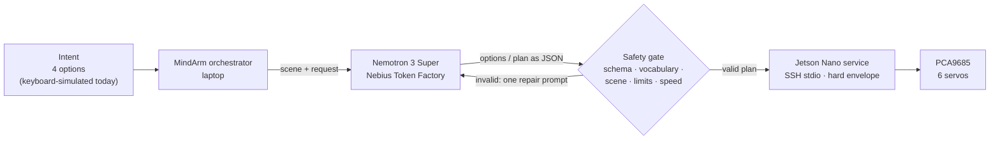

# MindArm

**A low-cost assistive arm, brain-controlled through intent selection: you choose the goal,
NVIDIA Nemotron plans it, and a 3D-printed arm on a Jetson Nano carries it out within
hard safety limits.**

Solo entry for the Nebius x NVIDIA Global AI Hackathon, Physical AI track.

> **Honest status of this build.** The arm is real and moves through Nemotron-generated,
> validated plans on a Jetson Nano. Intent selection is a **keyboard-driven simulation**:
> the EEG hardware is wired and verified, but no decoder turns brain signals into choices
> yet. This is a supervised tabletop prototype, not a medical or assistive device.

Demo video: [VIDEO LINK]

## The problem

People living with ALS, high spinal cord injury, or locked-in syndrome often cannot use a
joystick or a touchscreen. Non-invasive brain-computer interfaces give them only a few reliable
choices at a time. Asking that narrow channel to steer six joints in real time is slow and
exhausting.

MindArm changes what the brain has to do: **choose the goal, not the joints**. The user picks
one of four options, such as "Pick up the bottle". Nemotron turns that choice into a short
plan from a closed vocabulary of motion primitives, and the arm executes it within limits it
enforces itself. Four options match the kind of low-bandwidth signal a visual BCI can provide:
the interface will present them as tiles flickering at 8.57, 10, 12, and 15 Hz (SSVEP).

There is no clinical validation. Testing with the people this is meant for is a next step,
not a claim.

## How it works



**The cloud reasons, the edge enforces.** Nemotron 3 Super (120B parameters) runs on Nebius
Token Factory. The Jetson Nano (4 GB, JetPack 4.6) does not host it. It does what an edge
device can guarantee locally: deterministic, rate-limited servo control and an independent
safety envelope that holds even if the laptop or the model misbehaves. The laptop orchestrates
the two.

1. **Engage** (key `e`). MindArm reads the scene; today it comes from a fixture of the
   objects on the table.
2. **Propose.** Nemotron returns exactly four distinct options as JSON, one of them `Home`.
3. **Select** (keys `1`–`4`). In the planned BCI, looking at a flickering tile selects it.
4. **Plan.** Nemotron maps the option to primitives: `MOVE_ABOVE <object>`, `GRASP`, `LIFT`,
   `MOVE_TO_POSE handover`, `RELEASE`, `HOME`. It never outputs angles, pulses, or speeds.
5. **Validate.** The plan must pass the JSON schema, the closed vocabulary, and the
   scene-object check. The arm then preflights every target against joint limits and
   maximum speeds before anything moves.
6. **Execute** on the real arm, one primitive at a time, while the keyboard stays live.
   Pressing `e` cancels the move in progress and returns HOME.
7. **Repeat.** Fresh options are proposed after each cycle.

## How we use Nebius Token Factory and NVIDIA Nemotron

- **Model:** `nvidia/nemotron-3-super-120b-a12b`, called through Token Factory's
  OpenAI-compatible Chat Completions API (`src/mindarm/planner/nemotron.py`).
- **Two calls per cycle:** `propose_options` (scene → four goals) and `plan_motion`
  (goal → primitives). Prompts are in `src/mindarm/planner/prompts.py`.
- **Contract-first output, enforced twice:**
  - Token Factory decodes against a strict JSON Schema (`response_format: json_schema,
    strict: true`) built for each scene. Each primitive is an `anyOf` branch, so only
    `MOVE_ABOVE` can carry an `object_label`, and that label must come from an enum of the
    objects in the current scene.
  - Local Pydantic validation stays as the second layer. Invalid output gets exactly one
    repair attempt that includes the validation error. A second failure falls back to safe
    resting options or `[HOME]`.
  - A timeout, connection error, or HTTP 5xx gets one retry, separate from the repair. SDK
    retries are disabled, so an operation makes at most three calls.
  - Every call is logged with its latency, tokens (including cached and reasoning tokens),
    and settings.
- **Reasoning is set per operation** (`chat_template_kwargs: {"enable_thinking": ...}`) and is
  off for both, because the benchmark showed it bought nothing here (see below).
- **Measured with a reproducible benchmark**, `python -m mindarm.bench` (see "Run it"). It
  plans the options the model just proposed, as the live loop does, and logs every call.

Before and after, on 2026-10-29 (details and every variant in `docs/SPEC.md`):

| Configuration | Proposals p50 / p95 | Plans p50 / p95 | Plans valid on first try | Cost per cycle |
| --- | --- | --- | --- | --- |
| Before: JSON mode, reasoning on, N=10 | 2.36 / 3.69 s | 4.88 / 6.05 s | 6/10 (4 repaired) | $0.0011 |
| Now: strict schema, reasoning off, N=30 | **0.76 / 1.17 s** | **0.54 / 0.99 s** | **30/30** | **$0.00027** |

  - **What failed before:** all four rejected plans put an `object_label` on an action other
    than `MOVE_ABOVE`. The gate rejected each one and one repair prompt fixed it.
  - **What fixed it:** the per-scene schema and the exact handover sequence in the prompt.
    With that prompt, JSON mode alone also passed 20/20, so we don't credit strict decoding
    with a measured gain. It turns the structure into a guarantee from the service.
  - **Every plan is complete:** 30/30 matched the expected plan, the five-step handover for
    an object and `[HOME]` for anything else.
    A CLI run surfaced the gap first: before the prompt fix, a live plan stopped at `LIFT`,
    and the following HOME would have dropped the object.
  - **The second layer still matters:** Nano broke the one rule a JSON Schema can't express
    (Home must plan exactly `[HOME]`) in 3 of 10 plans. The local gate rejected them and the
    repair prompt fixed them.
  - **The transient retry has fired live:** during a Nano run, one call timed out at 30 s and
    the retry recovered it.
  - Prices come from Token Factory's own model list, cached tokens included; 67% of prompt
    tokens were served from cache.
  - The p95 is not a worst case: one cold first proposal of a session, with nothing cached,
    took 11.3 s.
- **Why Nemotron 3 Super, chosen with data.** Same configuration for every model:

| Model | Proposals p50 / p95 | Plans p50 / p95 | Plans valid on first try | Cached prompt tokens | Cost per cycle |
| --- | --- | --- | --- | --- | --- |
| **Nemotron 3 Super** (120B, N=30) | 0.76 / 1.17 s | 0.54 / 0.99 s | 30/30 | 67% | $0.00027 |
| Nemotron 3 Ultra (550B, N=10) | 0.50 / 0.52 s | 0.49 / 0.53 s | 10/10 | 0 reported | $0.0015 |
| Nemotron 3 Nano (30B, N=10) | 1.38 / 3.79 s | 0.92 / 1.85 s | 7/10, 3 repaired | 0 reported | $0.00012 |

  Super is used for both operations. Ultra matched it on validity with a tighter p95, but it
  costs 5.6× more per cycle. Nano was the cheapest, but it needed repairs and was the
  slowest. Ultra is one setting away (`NEMOTRON_MODEL`) if p95 latency matters more than cost.
- **Measured, not yet in the loop:** **Nemotron 3.5 Super VL** read an image and returned JSON
  that validated directly as MindArm's `Scene` in 2.2 s, with object centers within 0.02 of
  the truth on a synthetic test image. Perception from the Jetson's camera is the next module
  to replace.

## Safety by design

| Layer | What it enforces |
| --- | --- |
| Model contract | Strict JSON Schema at decoding, then local validation: closed vocabulary; only `MOVE_ABOVE` takes an object, only `MOVE_TO_POSE` takes `home` or `handover`; `Home` must map to exactly `[HOME]` (checked locally only) |
| Scene check | `MOVE_ABOVE` may only name an object in the current scene |
| Laptop preflight | Every target within joint limits, every move within max speed, no clamping; an invalid submission is rejected before any motion |
| Jetson service | An independent hard envelope (calibration limits, 1000 µs/s speed cap, durations in (0, 10] s). It rejects anything outside it, whatever the laptop sends |
| Execution | One primitive at a time on a worker, with the keyboard still polled. Disengage, error, or quit cancels the move and commands HOME |
| Link loss | The service stops the ramp and holds the posture; nothing moves while the link is down |

Known limits: there is no collision avoidance, no position feedback, and no force sensing. The
only stops are disengage/quit and cutting the servo supply. See "Open risks" in `docs/SPEC.md`.

## Hardware

| Part | Role |
| --- | --- |
| 3D-printed 6-DOF arm (built before Aug 26, 2026) | base, shoulder, elbow (MG996R), wrist pitch and roll (MG90S), gripper (SG90) |
| NVIDIA Jetson Nano 4GB (L4T R32.7.5) | Runs the arm service; drives the servos over I2C |
| PCA9685 at 0x40 on I2C bus 1 | 50 Hz servo PWM; servo power from a separate 5 V 10 A supply |
| USB UVC camera on the Jetson | Live view while teaching poses; planned input for perception |
| 2× AD8232 + 2× ADS1115 (0x48, 0x49) on I2C bus 0 | Two-channel EEG acquisition at 250 Hz; verified, not yet used for intent |
| Laptop | Orchestrator, Nemotron calls, keyboard intent; reaches the Jetson over the micro-USB network link |

The laptop talks to the Jetson only over SSH stdin/stdout. The Jetson keeps its firewall and
disabled port forwarding. The Jetson runs Python 3.6 with only `python3-smbus`. Before EEG
electrodes go on a person, the sensors need galvanic isolation from mains-powered equipment.

## Run it

Requires Python 3.10+. From this directory:

```console
python -m pip install -e ".[dev]"
python -m mindarm --planner fake          # full loop offline, simulated arm
```

**Real Nemotron:** copy `.env.example` to `.env`, set `NEBIUS_API_KEY`, then run
`python -m mindarm`. Press `e`, wait for four options, press `1`–`4`. Press `e` to return HOME
and disengage, or `q` to quit. `--once` runs a single cycle.

**Real arm:**

1. Copy `jetson/mindarm_arm.py` to the Jetson's home directory.
2. Set `arm: jetson` in `config/settings.yaml`. `jetson_command` is configured for a Windows
   laptop using the SSH alias `jetson-usb`; adjust it for your setup.
3. Place the arm near HOME by hand and power the servos.
4. Run `python -m mindarm`. At startup the service energizes the channels one at a time at HOME.

`python -m mindarm.teach` serves a local page (127.0.0.1:8766) with the Jetson camera, joint
sliders, and buttons to save the taught poses into `config/jetson_arm.yaml`.

**Tests:** `pytest` runs the offline suite (106 tests, network blocked). `pytest -m integration`
calls the real API and fails if either operation needed the fallback.

**Benchmark:** `python -m mindarm.bench --n 10` runs N proposals and N plans through the live
planner on the fixture scene and prints p50/p95, validity on the first try, repairs,
fallbacks, rejection reasons, tokens (cached and reasoning), and cost at the prices that
Token Factory's model list reports. `--model`, `--propose-reasoning on|off`,
`--plan-reasoning on|off`, `--propose-format strict|object`, and `--plan-format strict|object`
override the configuration. Every call is logged to `logs/`. No test runs it.

Each session writes `logs/<session-id>.jsonl` (cycles, plans, results, latencies, every model
call) and, when EEG is enabled, `recordings/<session-id>.npz`.

## Repository map

| Path | Contents |
| --- | --- |
| `src/mindarm/interfaces.py` | Protocols and Pydantic models: the contract every module implements |
| `src/mindarm/orchestrator.py` | State machine: IDLE → PROPOSING → SELECTING → PLANNING → EXECUTING |
| `src/mindarm/planner/` | Nemotron planner, prompts, offline planner |
| `src/mindarm/arm/` | Simulated arm and the Jetson arm adapter |
| `jetson/mindarm_arm.py` | The service deployed on the Jetson |
| `src/mindarm/eeg/` | Synthetic EEG, NPZ recording and replay |
| `config/` | Settings, simulator limits, real-arm limits and taught poses (µs) |
| `docs/SPEC.md` | Source of truth: contracts, safety behavior, measurements, open risks |

## What is new for this hackathon

The 3D-printed arm existed before August 26, 2026. Everything else is new work for this entry:
the orchestrator, the Nemotron planner and its validation, the Jetson arm service and safety
envelope, the pose teaching tool, the EEG acquisition stack, and the hardware integration.

## Prior work

Maha Nawaz, Abdul Basit, and Muhammad Shafique,
["MindArm: Mechanized Intelligent Non-Invasive Neuro-Driven Prosthetic Arm System"](https://arxiv.org/abs/2403.19992)
(2024), describes a DNN-based EEG system with three fixed actions: idle, handshake, and cup
pickup. This project plans SSVEP intent selection instead of a DNN on raw EEG, and uses
scene-aware options from Nemotron instead of three fixed actions.

## Feedback on Nebius Token Factory and NVIDIA

What worked well:

- The OpenAI-compatible API meant no new client code.
- Strict structured output works with a real schema: `json_schema` with `strict: true`,
  per-action `anyOf` branches, and an enum of scene labels was accepted as is, and Nemotron 3
  Super then produced 30/30 valid, complete plans at 0.54 s p50.
- `GET /v1/models?verbose=true` lists per-token prices, including the cache-read price, so
  our benchmark computes cost from the provider's own numbers.
- Latency and price fit an interactive loop: about 1.3 s of model time and $0.00027 per full
  cycle.
- Prompt caching applied automatically on Super: 67% of our prompt tokens were cached.

What slowed us down:

- **Billing country:** Peru is not in the billing "Country of residence" list, which blocks
  onboarding and API key creation for participants there.
- **Two endpoints, two catalogs:** `api.tokenfactory.us-central1.nebius.com` listed 18 models
  and `api.tokenfactory.nebius.com` listed 30. Nemotron 3.5 Super VL appeared only on the
  second. The documentation and the cookbook use different endpoints.
- **Reasoning controls:** turning reasoning off (`chat_template_kwargs`) cut latency by
  3–7×, but we found the parameter in third-party docs, not in Token Factory's.
- **Reasoning and `max_tokens`:** with JSON mode and a small budget (256), reasoning can
  consume every token, leaving a truncated response with no answer.
- **Cached tokens on Ultra and Nano:** repeated identical prompts reported 0 cached tokens on
  both, although the model list gives them a cache-read price. Super reported cache hits.
- **Transient failures:** one HTTP 500 on the first call of a session (identical requests
  right after succeeded), and one Nano call that timed out at 30 s. MindArm now retries such
  failures once.

## Roadmap

1. Perception from the Jetson camera with Nemotron 3.5 Super VL.
2. A web operator console with the flickering SSVEP option tiles.
3. Galvanic isolation for the EEG front end, then SSVEP and alpha decoding from recordings.
4. Stable object IDs, so two objects with the same label can be told apart.
5. Batch evaluation of the planner over recorded scenes as a Nebius Serverless Job, tracking
   validity, latency, and cost per model.
6. Sessions with people who live with motor impairments, to shape the options and the pace.

## License

[MIT](LICENSE).
